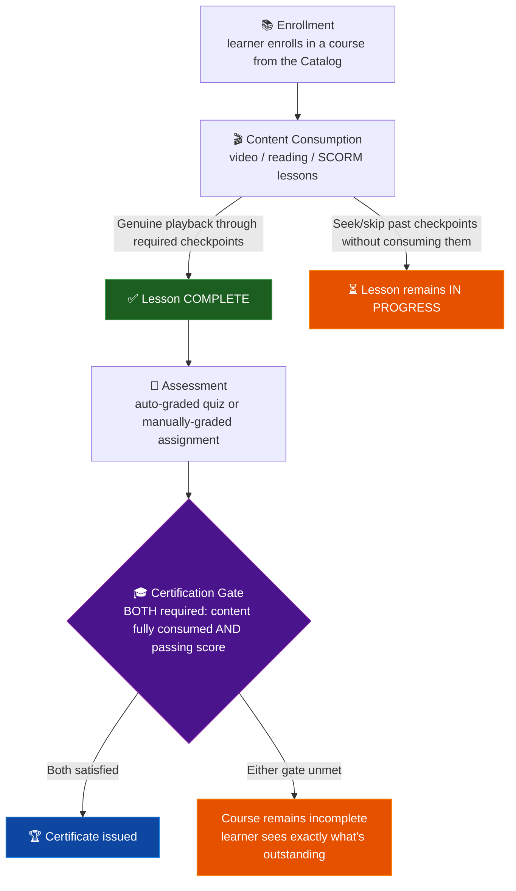

# 🎓 LMS Platform

**A Learning Management System (course delivery, assessments & certification) — QA & Automation Portfolio Project**

> This repository documents the QA strategy, test automation, and testing approach behind a
> sample **Learning Management System (LMS)** — a platform where learners enroll in courses,
> work through content (video, reading, SCORM), sit assessments, and earn certificates.
>
> All content here uses **generic/sample data only**. No client names, company names, or
> confidential/production information appear anywhere. Dates and timelines are placeholders —
> update `[Timeline]` before publishing.
>
> 📍 **New here?** [`docs/README.md`](./docs/README.md) is a documentation map — it answers what
> this is, how it works, who's involved, and what it depends on, with a suggested reading order
> through the rest of the repo.

---

## 📖 Table of Contents

1. [What is an LMS?](#-what-is-an-lms)
2. [My Role](#-my-role)
3. [Tech Stack & Tools Used](#-tech-stack--tools-used)
4. [Types of Testing Performed](#-types-of-testing-performed)
5. [How It Works — Course Completion Flow](#-how-it-works--course-completion-flow)
6. [Key Achievements](#-key-achievements)
7. [Automation Approach](#-automation-approach)
8. [Regression Checklist](#-regression-checklist)
9. [Screenshots & Reports](#-screenshots--reports)
10. [Repository Structure](#-repository-structure)

> For deeper dives not covered inline here: [Modules, Submodules & Stakeholders](./docs/business-overview.md),
> [Architecture, Flow & Sequence Diagrams](./docs/architecture-and-flow.md),
> [Tech Stack & Skills Demonstrated](./docs/tech-and-skills.md), [UI Consistency](./docs/ui-consistency.md)
> — or see [`docs/README.md`](./docs/README.md) for the full map. Every diagram in this repo is
> drawn in Mermaid and renders directly on GitHub, so there's nothing to open elsewhere.

---

## 💡 What is an LMS?

A Learning Management System lets learners browse a course catalog, enroll, work through content
— video, reading material, SCORM or xAPI packages — sit assessments, and earn a certificate once
they've finished.

For anyone new to ed-tech QA: a certificate is a credential. The platform has to be able to prove
a learner genuinely engaged with the material and passed the assessment, not just that a progress
bar reached 100%. That distinction drives almost everything in this repo's test design.

### Who typically interacts with it?

| Role | What they do |
|---|---|
| **Learner / Student** | Enrolls, works through content, sits assessments, earns certificates |
| **Instructor** | Authors courses and assessments, monitors progress, grades manual assignments |
| **Course Admin** | Manages catalog structure and publishing/enrollment rules |
| **Platform Admin** | Manages platform-wide configuration and system health |

---

## 👤 My Role

QA Engineer / SDET for the LMS module, owning manual and automated coverage across
content-consumption tracking, assessment grading, and certification integrity.

- Owned QA strategy for the full journey: enrollment, content consumption, assessment,
  certification
- Designed and executed automation covering progress-tracking correctness, including
  seek-vs-genuine-playback scenarios
- Ran API testing against assessment scoring calculations and completion-criteria gating logic
- Focused test design on progress and completion integrity, the highest-severity risk category for
  a platform whose end product is a credential
- Logged, triaged, and tracked defects through their full lifecycle

**Timeline:** `[Add Duration]`

---

## 🛠 Tech Stack & Tools Used

| Category | Tools |
|---|---|
| **UI Automation** | Playwright, TypeScript |
| **BDD Framework** | Cucumber |
| **API Testing & Automation** | Postman |
| **Performance Testing** | k6 (concurrent content-streaming and checkpoint-ingestion load around deadline-driven spikes) |
| **CI/CD** | Jenkins / GitHub Actions |
| **Bug Tracking & Traceability** | JIRA, RTM (Requirement Traceability Matrix — see [`sample-rtm.md`](./sample-rtm.md)) |
| **Version Control** | Git, GitHub |

> For why each tool was chosen, a skill-to-proof map, and the performance testing approach in
> full: [`docs/tech-and-skills.md`](./docs/tech-and-skills.md).

---

## 🧪 Types of Testing Performed

- **Functional Testing** — enrollment, content consumption, assessments, certification
- **Regression Testing** — the full enrollment-to-certification suite, run before every release
- **API Testing** — progress-tracking events, assessment scoring, certification-eligibility checks
- **Negative Testing** — seek-without-watching, unanswered-question scoring, blocking
  certification on a failed assessment
- **Cross-Content-Package Consistency Testing** — SCORM/xAPI package variability
- **Performance Testing** — concurrent content-streaming and checkpoint-ingestion load around
  deadline-driven spikes, run with k6 (see [`docs/tech-and-skills.md`](./docs/tech-and-skills.md)
  section 5)
- **Cross-Browser Testing**
- **Smoke & Sanity Testing** — post-deployment health checks

---

## 🔄 How It Works — Course Completion Flow



Content-consumption completion and passing-score completion are independent gates. A certificate
should never be issued on partial satisfaction of either one, and "reached the end of a video"
should never be treated as equivalent to "watched the video." [`docs/business-overview.md`](./docs/business-overview.md)
section 4 has the full rationale; [`docs/architecture-and-flow.md`](./docs/architecture-and-flow.md)
walks through how a false-completion or scoring defect actually happens under the hood.

### Admin Functions

- Course catalog and publishing management
- Instructor grading queue for manual assignments
- Compliance/L&D completion reporting

---

## 🏆 Key Achievements

- Built a progress-tracking regression suite that treats false completion (seek vs. genuine
  playback) as a first-priority scenario — caught a critical defect where seeking to a video's end
  falsely marked it complete (see [`sample-defect-report.md`](./sample-defect-report.md) Defect #1)
- Validated assessment scoring accuracy and caught a scoring-denominator defect that inflated
  scores whenever a question was left unanswered
- Verified cross-content-package consistency, treating SCORM/xAPI authoring-tool variability as
  its own test dimension rather than an edge case
- Tracked defects across completion-integrity and grading-accuracy themes through their full
  lifecycle

---

## 🤖 Automation Approach

Automation is built with **Playwright + TypeScript**, using **Cucumber (BDD)** for scenario
definition, covering the enrollment-to-certification journey and backed by Postman for API
coverage and k6 for concurrent-streaming performance testing (see
[`docs/tech-and-skills.md`](./docs/tech-and-skills.md) section 5).

### Priority Automated Scenarios

1. Enrollment happy path
2. Watching a video fully marks the lesson complete; seeking to the end does not
3. Auto-graded quiz scoring accuracy
4. Certification issued only when both the content and assessment gates are met
5. Cross-content-package consistency checks
6. Concurrent content-streaming / checkpoint-ingestion load testing (k6)

See [`automation/`](./automation) for the framework README and a sample feature file with step
definitions, built on dummy data.

---

## ✅ Regression Checklist

- [ ] Enrollment (single, duplicate prevention)
- [ ] Content Consumption & Progress Tracking (video, SCORM, cross-package consistency)
- [ ] Assessment & Grading (auto-graded, manually-graded)
- [ ] Certification (both gates required, neither alone is sufficient)
- [ ] Discussion / Forums (course-scoped visibility)
- [ ] UI Consistency (status labeling, progress percentage, terminology, accessibility)

Full checklist with edge cases: [`regression-checklist.md`](./regression-checklist.md).

---

## 📸 Screenshots & Reports

Sample test execution reports, defect report templates, and a worked Requirement Traceability
Matrix live in [`regression-execution-summary.md`](./regression-execution-summary.md),
[`sample-defect-report.md`](./sample-defect-report.md), and [`sample-rtm.md`](./sample-rtm.md).

---

## 📁 Repository Structure

> **New here?** Start with [`docs/README.md`](./docs/README.md) — a documentation map that points
> to exactly the right doc for each question you're likely to have.

```
lms-platform/
├── README.md
├── regression-checklist.md          → Full regression suite + edge cases
├── sample-defect-report.md          → Defect theme taxonomy + worked defect examples
├── sample-rtm.md                    → Worked Requirement Traceability Matrix, including real coverage gaps
├── regression-execution-summary.md  → Sample regression test execution report
├── docs/
│   ├── README.md                    → 📍 Documentation map — start here
│   ├── business-overview.md         → What this is, modules/submodules, glossary, completion-integrity risk model
│   ├── architecture-and-flow.md     → Mermaid sequence/flow diagrams: checkpoint tracking, the
│   │                                    Defect #1/#2 mechanisms, assessment/certification flow
│   ├── tech-and-skills.md           → Full tech stack (with why), skill → proof map, CI/CD shape, performance depth
│   └── ui-consistency.md            → Cross-screen UI/UX consistency (completion status, progress %, a11y)
└── automation/
    ├── README.md                          → Framework setup & structure
    ├── sample-progress-tracking.feature   → Sample Cucumber (BDD) feature file
    └── sample-progress-tracking.steps.ts  → Sample Playwright + TypeScript step definitions
```

> **Note on structure:** `bug-reports/`, `test-cases/`, and `test-reports/` started as empty
> placeholder folders and were flattened away once real content existed — a folder holding one
> file (or none) adds navigation overhead without organizing anything. `docs/` and `automation/`
> stayed as folders because each genuinely groups several related files.
