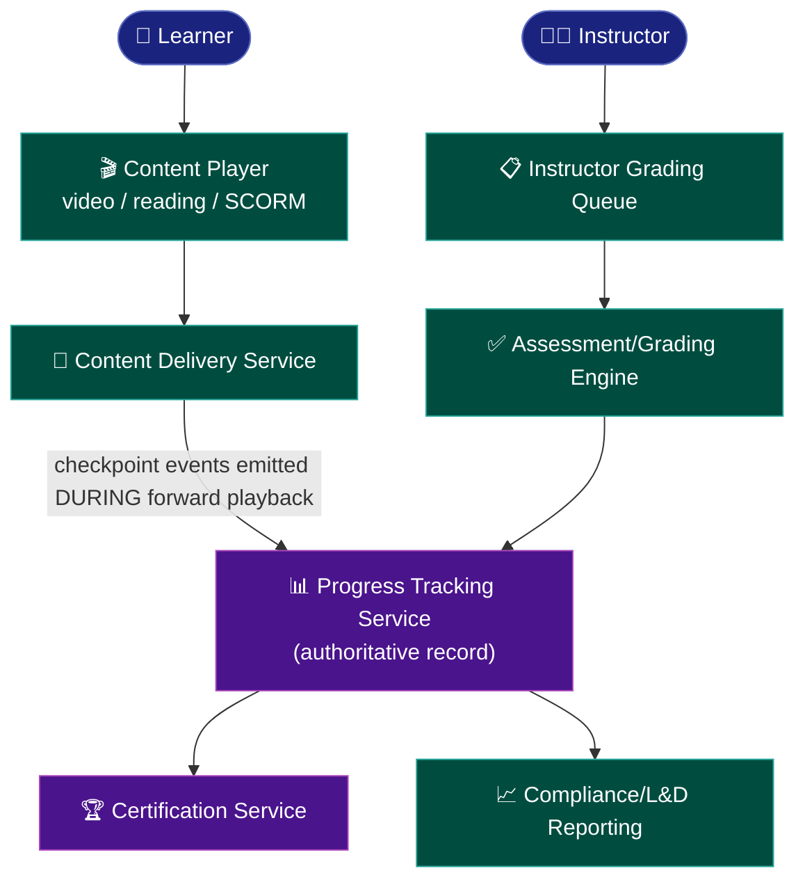
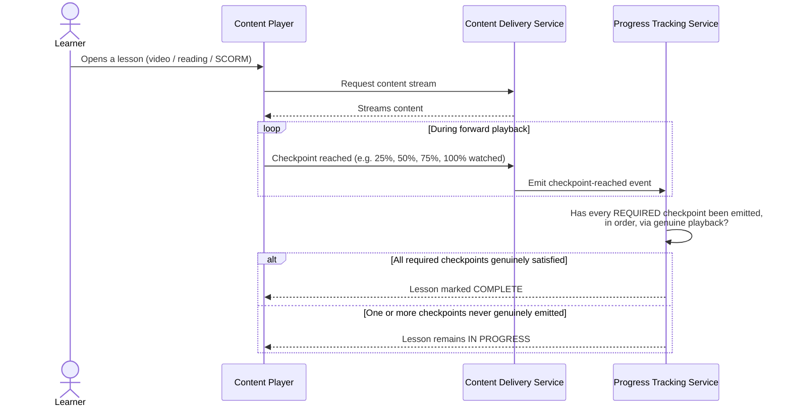
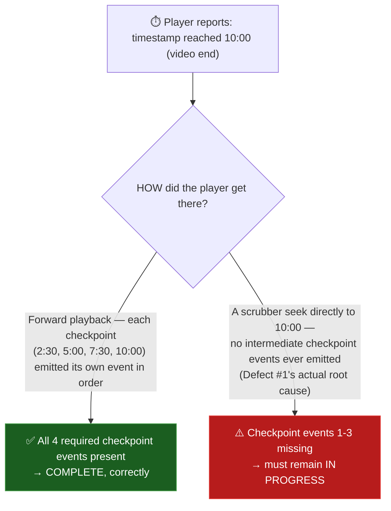
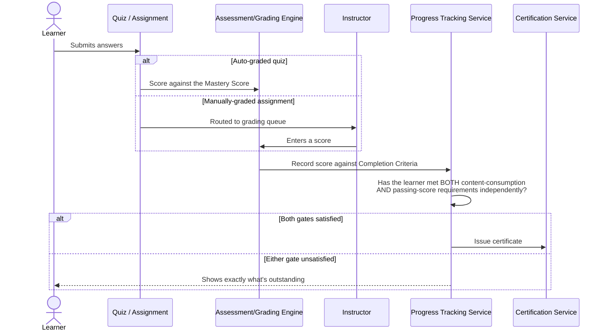
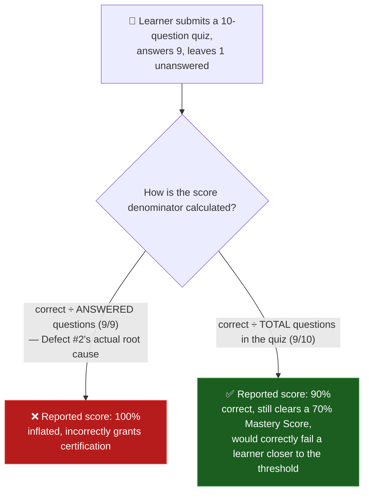

# LMS Platform — Architecture & Flow

> See [`business-overview.md`](./business-overview.md) for why progress/completion integrity is
> this product's central risk, [`tech-and-skills.md`](./tech-and-skills.md) for the tools and
> skills behind this testing approach, and [`README.md`](./README.md) for the full documentation
> map.
>
> Every diagram below is drawn in <a href="https://mermaid.js.org/" target="_blank" rel="noopener noreferrer">Mermaid</a>, which GitHub renders
> natively in-page — nothing here requires opening another site or tool to read it.

## 1. System Interaction Map

Checkpoint events flow one way, from Content Delivery into Progress Tracking, and never the
reverse. Per [`business-overview.md`](./business-overview.md) section 6, Progress Tracking is the
single most load-bearing dependency in this platform — both Certification and Compliance/L&D
reporting trust it completely. Section 3 below shows what goes wrong once the *player* is trusted
to self-report "complete," instead of the tracking service independently verifying it from raw
events.

## 2. Content Consumption & Progress Tracking Flow

"Reached the end of the video" and "watched the video" aren't the same event. Section 3 covers why
a single "current playback position" check can't tell them apart, and what has to replace it.

## 3. The Real Mechanism Behind Defect #1 — Checkpoints vs. a Single Position Check

[`sample-defect-report.md`](../sample-defect-report.md) Defect #1 happened because the tracking
logic asked one question — did the player's current timestamp ever reach the video's end? — and a
scrubber seek satisfies that just as easily as genuine playback does. The fix needed a different
*shape* of check entirely:

This is a lesson worth naming precisely, because it recurs in different disguises: real SCORM
video players that ship a client-side "disable seeking" toggle are documented to be bypassable
anyway — a determined user can still fast-forward even when the player's own UI tries to stop
them. Seek-prevention can't be the real control, for the same reason a disabled form field isn't a
real access-control boundary. The only check that actually holds is server-side: did the Content
Delivery Service genuinely emit *every required intermediate checkpoint event*, not just "was the
final timestamp ever reached." A single position value that a seek can set directly is never
enough; what Progress Tracking actually has to verify is a sequence of discrete events that a seek
skips straight over.

Where this maps onto SCORM versus xAPI, concretely: SCORM's native tracking granularity sits at
the course/lesson level — a `completed`/`passed` status, a score, total time — coarse enough that
a single "reached the end" signal is exactly the shape of data a naive integration ends up
trusting. xAPI's Actor-Verb-Object statement model (e.g., "Learner *experienced* Segment-3-of-5")
is built for finer granularity than that. A platform that wants genuine per-checkpoint
verification is better served treating xAPI-style discrete statements as the source of truth, and
treating a SCORM package's own self-reported "completed" flag as a hint to verify against that
granular event stream, rather than trusting it on its own.

## 4. Assessment & Certification Flow

## 5. The Real Mechanism Behind Defect #2 — the Scoring Denominator

What makes this bug dangerous is that it doesn't always produce a wrong pass/fail outcome. In this
worked example, both 90% and 100% clear a 70% Mastery Score, so the learner is certified correctly
either way — which is exactly how a denominator bug like this can ship unnoticed for a long time.
It only becomes visible for a learner whose *true* score (correct ÷ total) sits below the Mastery
Score while their *inflated* score (correct ÷ answered) sits above it — say, 6 correct out of 10
total (60%, a fail) reported as 6 out of 7 answered (86%, an incorrect pass). `TC-008`/`TC-009` in
[`regression-checklist.md`](../regression-checklist.md) need a case built specifically near that
threshold to catch it — not just any quiz with one skipped question.

## 6. Why SCORM/xAPI Package Variability Is a Cross-Content Consistency Risk

Not every course's content package — SCORM vs. xAPI, and across different authoring tools —
emits tracking events in exactly the same shape. It's the same risk category as an integration
depending on several third-party sources that don't all behave identically: a progress-tracking
defect that only shows up for courses built with one specific authoring tool stays invisible if
testing only ever exercises a single "reference" course's package. `TC-007` exists specifically to
force at least two different package sources through the same assertion.

---

**Sources for the real-world standards referenced above**, used to ground these diagrams in
genuine e-learning tracking practice rather than invented mechanics:
<a href="https://www.ispringsolutions.com/blog/xapi-vs-scorm" target="_blank" rel="noopener noreferrer">SCORM vs. xAPI tracking granularity — iSpring</a>,
<a href="https://support.schoox.com/hc/en-us/articles/35705363869591-Controlling-Fast-Forwarding-in-SCORM-Lectures" target="_blank" rel="noopener noreferrer">SCORM seek/fast-forward prevention being bypassable client-side — Schoox</a>.
