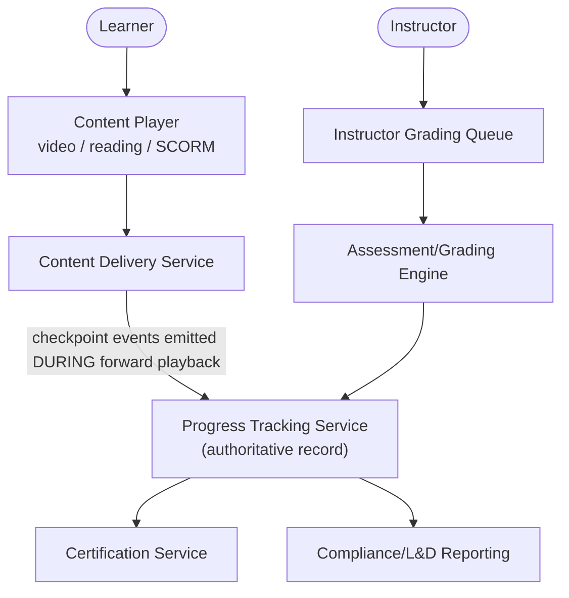
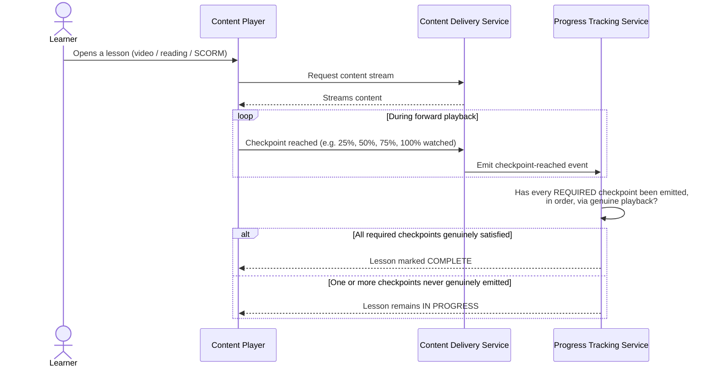
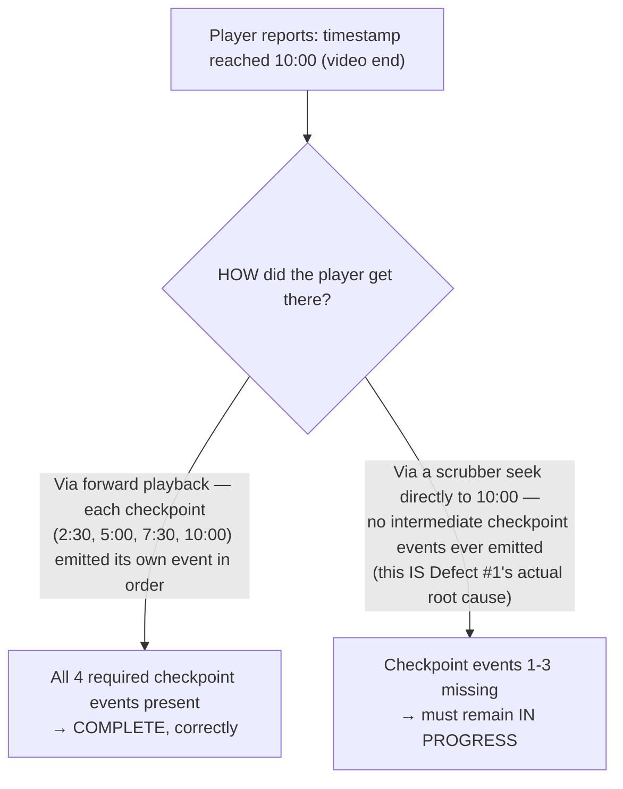
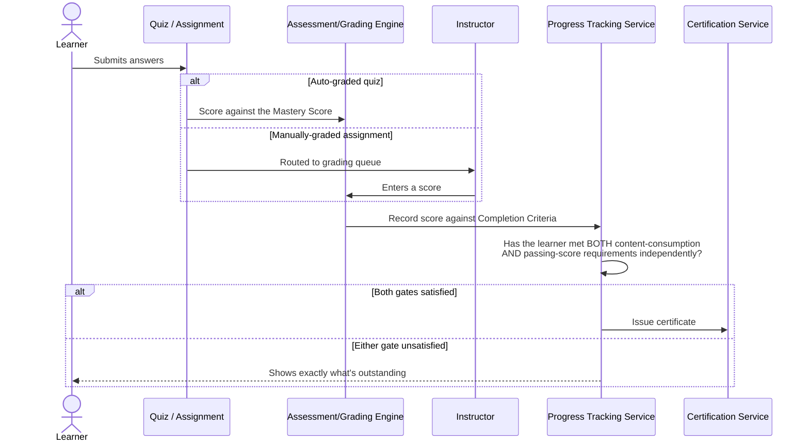
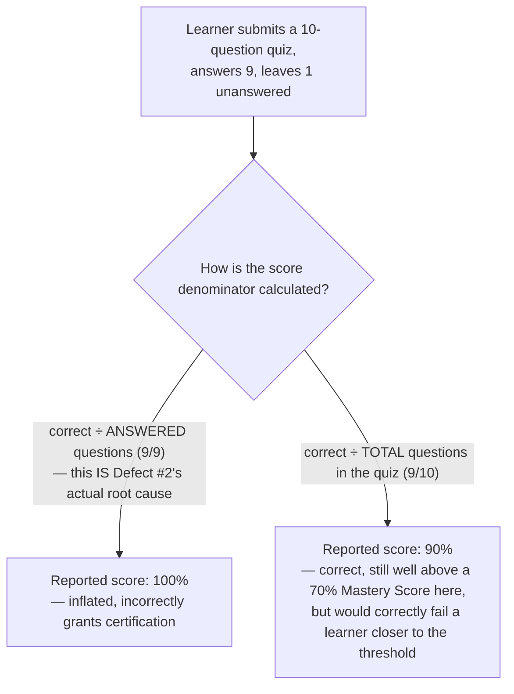

# LMS Platform — Architecture & Flow

> See [`business-overview.md`](./business-overview.md) for why progress/completion integrity is
> this product's central risk, [`tech-and-skills.md`](./tech-and-skills.md) for the tools and
> skills behind this testing approach, and [`README.md`](./README.md) for the full documentation
> map.
>
> Every diagram below is drawn in [Mermaid](https://mermaid.js.org/), which GitHub renders
> natively in-page — nothing here requires opening another site or tool to read it.

## 1. System Interaction Map

**Why checkpoint events flow one-way from Content Delivery into Progress Tracking, never the
reverse:** per [`business-overview.md`](./business-overview.md) section 6, Progress Tracking is
the single most load-bearing dependency in this platform — both Certification and
Compliance/L&D reporting trust it completely. Section 3 below shows exactly what goes wrong when
the *player* is trusted to self-report "complete" instead of the tracking service independently
verifying it from raw events.

## 2. Content Consumption & Progress Tracking Flow

**Key testing principle:** "reached the end of the video" and "watched the video" are not the
same event — see section 3 for exactly why a single "current playback position" check can't tell
them apart, and what has to replace it.

## 3. The Real Mechanism Behind Defect #1 — Checkpoints vs. a Single Position Check

[`sample-defect-report.md`](../sample-defect-report.md) Defect #1 happened because the tracking
logic asked one question — "did the player's current timestamp ever reach the video's end?" —
which a scrubber seek satisfies just as easily as genuine playback does. The fix is a different
*shape* of check entirely:

**Why this is the same lesson this portfolio's other repos keep re-deriving in different
domains:** real SCORM video players that ship a client-side "disable seeking" toggle are
documented to be bypassable anyway — a determined client can still fast-forward even when the
player's own UI tries to prevent it. That means seek-prevention **cannot be the actual control**,
the same way a disabled form field isn't a real access-control boundary (see the HRMS platform's
own `architecture-and-flow.md` for that exact same pattern in a completely different domain). The
only check that actually works is server-side: did the Content Delivery Service genuinely emit
*every required intermediate checkpoint event*, not just "was the final timestamp ever reached."
A single position value a seek can set directly is never sufficient; a sequence of discrete
events a seek *skips over* is what the Progress Tracking Service actually has to verify.

**Where this maps onto SCORM vs. xAPI, concretely:** SCORM's native tracking granularity is
course/lesson-level (a `completed`/`passed` status, a score, total time) — coarse enough that a
single "reached the end" signal is exactly the shape of data a naive integration ends up trusting.
xAPI's Actor-Verb-Object statement model (e.g., "Learner *experienced* Segment-3-of-5") is built
for exactly this finer granularity — a platform that wants genuine per-checkpoint verification is
better served treating xAPI-style discrete statements as the source of truth, and treating a
SCORM package's own self-reported "completed" flag as a hint to verify against that granular
event stream, not as authoritative on its own.

## 4. Assessment & Certification Flow

## 5. The Real Mechanism Behind Defect #2 — the Scoring Denominator

**Why this bug is dangerous specifically *because* it doesn't always produce a wrong pass/fail
outcome:** in this exact worked example, 90% and 100% both clear a 70% Mastery Score, so the
learner is certified correctly either way — which is exactly how a denominator bug like this can
ship unnoticed for a long time. The defect becomes visible only for a learner whose *true* score
(correct ÷ total) sits below the Mastery Score while their *inflated* score (correct ÷ answered)
sits above it — e.g., 6 correct out of 10 total (60%, a fail) reported as 6 out of 7 answered
(86%, an incorrect pass). `TC-008`/`TC-009` in
[`regression-checklist.md`](../regression-checklist.md) need a case constructed specifically
near that threshold, not just any quiz with one skipped question, to actually catch this.

## 6. Why SCORM/xAPI Package Variability Is a Cross-Content Consistency Risk

Not every course's content package (SCORM vs. xAPI, and across different authoring tools) emits
tracking events in exactly the same shape. This is conceptually the same risk category as this
portfolio's other integration-dependent products (BBPS's biller-integration variability, for
example) — a progress-tracking defect that only manifests for courses built with a specific
authoring tool is invisible if testing only ever uses one "reference" course's content package.
`TC-007` exists specifically to force at least two different package sources through the same
assertion.

---

**Sources for the real-world standards referenced above** (used to ground this document's
diagrams in genuine e-learning tracking practice, not invented mechanics):
[SCORM vs. xAPI tracking granularity — iSpring](https://www.ispringsolutions.com/blog/xapi-vs-scorm),
[SCORM seek/fast-forward prevention being bypassable client-side — Schoox](https://support.schoox.com/hc/en-us/articles/35705363869591-Controlling-Fast-Forwarding-in-SCORM-Lectures).
