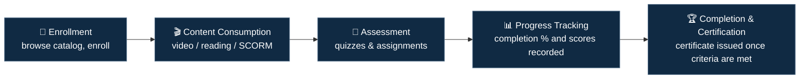

# LMS Platform — Business Overview

> **Start here if you're new to ed-tech QA, in HR, or coming from a non-QA technical role.** This
> document covers what a Learning Management System does and why progress/completion integrity is
> the central testing concern, before you look at a single test case or line of code.

## 1. What problem does it solve?

A Learning Management System lets learners browse a course catalog, enroll, work through content
— video, reading material, SCORM packages — sit assessments, and earn a certificate once they've
finished, while giving instructors and admins the tools to author courses and track learner
progress at scale.

## 2. Core Modules and Their Submodules

| Module | Submodules / Key Components | Responsible For | Primarily Tested Via |
|---|---|---|---|
| **Course Catalog & Enrollment** | Catalog Browse/Search · Enrollment · Duplicate-Enrollment Prevention | Browsing, searching, and enrolling in courses | UI Automation |
| **Content Delivery** | Video Streaming · Reading Material Rendering · SCORM/xAPI Package Interpretation | Serving lesson content and emitting consumption events as the learner progresses | UI Automation + Cross-Package Consistency Testing |
| **Progress Tracking** | Checkpoint Event Ingestion · Completion-Criteria Evaluation | The authoritative record of genuine engagement — see [`architecture-and-flow.md`](./architecture-and-flow.md) sections 2–3 for why this has to be checkpoint-based rather than position-based | API Testing + Negative Testing |
| **Assessments & Quizzes** | Auto-Grading Engine · Manual Grading Queue · Score Calculation | Auto-graded and manually-graded knowledge checks — see [`architecture-and-flow.md`](./architecture-and-flow.md) section 5 for the scoring-denominator pitfall | API Testing |
| **Certification** | Dual-Gate Evaluation (content + score) · Certificate Issuance | Issued only once completion criteria — content consumption and a passing score — are independently met, never inferred from one gate alone | API Testing + Functional Testing |
| **Discussion / Forums** | Course-Scoped Visibility | Learner-instructor and learner-learner discussion, scoped strictly to the enrolling course | Functional Testing |
| **Instructor/Admin Course Authoring** | Course/Assessment Authoring · Publishing Workflow | Building and publishing course content and assessments | Functional Testing (Admin) |

Progress Tracking and Assessments are listed as separate modules even though both feed
Certification, because false completion and grading inaccuracy are independent risk categories
with different root causes — an engagement-tracking gap versus a scoring-calculation gap.
Collapsing them into one "completion" module would hide that fixing one says nothing about the
other, which is exactly what Defects #1 and #2 in [`sample-defect-report.md`](../sample-defect-report.md)
each demonstrate on their own.

## 3. Core Flow

## 4. Why Progress & Completion Integrity Is the Central Testing Theme

A certificate is a credential — a claim that the learner actually engaged with and passed the
material. That claim is only as trustworthy as the platform's progress-tracking logic, which
creates two closely related risk categories:

- **False completion** — content marked "complete" without the learner actually consuming it (a
  video seeked or skipped to the end, rather than watched, still registering 100% progress)
- **Grading inaccuracy** — an auto-graded quiz miscalculating a score, incorrectly denying or
  granting the passing threshold needed for certification

Both failure modes stay invisible in a UI walkthrough that only checks whether the progress bar
moves. Catching them means testing what's actually happening in the underlying tracking data, not
just what the UI displays.

## 5. Stakeholders / Involved Parties

| Stakeholder | Role in this module |
|---|---|
| **Learner / Student** | Enrolls, consumes content, takes assessments, earns certificates |
| **Instructor** | Authors course content and assessments, monitors learner progress, grades manual assignments |
| **Course Admin** | Manages course catalog structure, publishing workflow, and enrollment rules |
| **Platform Admin** | Manages platform-wide configuration, user roles, and system health |
| **Compliance/L&D Team** | Relies on accurate completion records for mandatory-training reporting |

## 6. Dependencies

### Internal Platform Dependencies

- **Progress Tracking Service** — the authoritative record of a learner's content-consumption and
  assessment state, and the single most load-bearing internal dependency, since Certification
  reads directly from it
- **Content Delivery / Streaming Service** — serves video and SCORM content and reports
  consumption events (play, pause, seek, complete) back to Progress Tracking
- **Assessment/Grading Engine** — scores quizzes and assignments against defined mastery thresholds
- **Certification Service** — issues certificates once completion criteria are satisfied

### External Dependencies

- **SCORM/xAPI Content Packages** — third-party or externally-authored content packages whose
  tracking-event format the platform has to interpret correctly
- **Learning Record Store (LRS)** — where xAPI is used, an external or embedded store of learning
  activity statements

## 7. Glossary

| Term | Meaning |
|---|---|
| **SCORM** | A standard packaging/tracking format for e-learning content |
| **xAPI (Tin Can API)** | A more flexible learning-activity tracking standard succeeding SCORM |
| **LRS (Learning Record Store)** | A system storing xAPI learning-activity statements |
| **Completion Criteria** | The rule(s) that determine when a course counts as complete (e.g. 100% content viewed + passing quiz score) |
| **Mastery Score** | The minimum score required to pass an assessment |
| **Enrollment** | The process of a learner joining a course |
| **Checkpoint Event** | A discrete signal emitted during genuine forward playback (e.g., "25% watched") — the unit Progress Tracking actually verifies, rather than trusting a single current-position value a seek can set directly |
| **Actor-Verb-Object Statement** | xAPI's granular activity-record shape (e.g., "Learner *experienced* Segment-3-of-5") — what makes fine-grained checkpoint tracking possible, unlike SCORM's coarser course-level completion signal |

## 8. Cross-Module Dependencies

- **Progress Tracking Service** — read by both Certification and any Compliance/L&D reporting; a
  defect here has the widest blast radius in the platform (see
  [`sample-defect-report.md`](../sample-defect-report.md) Defect #1)
- **Assessment/Grading Engine** — a scoring defect can silently block or incorrectly grant
  certification, independent of any content-consumption issue
