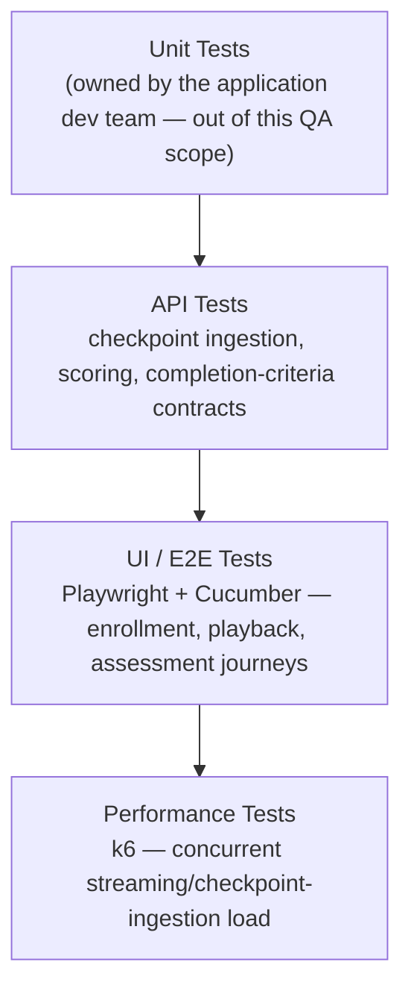
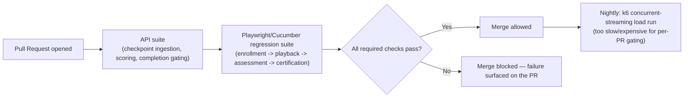

# LMS Platform — Tech Stack & Skills Demonstrated

> Everything in this doc is answerable by reading this repo alone — no need to visit an external
> site to understand what was used or why. See [`business-overview.md`](./business-overview.md)
> for the product/module breakdown and [`architecture-and-flow.md`](./architecture-and-flow.md)
> for how the system actually behaves.

## 1. Full Tech Stack, and Why Each Tool

| Category | Tool | Why This Tool Specifically |
|---|---|---|
| **UI Automation** | Playwright + TypeScript | Native video-player interaction support makes it practical to simulate both genuine playback and seek-only interaction as distinct, repeatable scenarios (see [`../automation/README.md`](../automation/README.md)) |
| **BDD Framework** | Cucumber | Completion-integrity rules (e.g., "seeking to the end should NOT mark a lesson complete") read as plain business rules a non-QA stakeholder — an L&D/Compliance reviewer — can verify independently, which matters specifically because this product's output is a credential they rely on |
| **API Testing & Automation** | Postman | Validates assessment scoring and completion-criteria gating directly against the contract, independent of what the player UI displays |
| **Performance Testing** | k6 | Load/spike testing for concurrent content-streaming and checkpoint-ingestion volume (section 5 below) — chosen to stay in the same JS ecosystem as Playwright |
| **CI/CD** | Jenkins / GitHub Actions | Automates the regression suite on a schedule/trigger — see section 4 for the suggested pipeline shape |
| **Bug Tracking & Traceability** | JIRA, RTM | Full defect lifecycle tracking plus requirement-to-test-coverage traceability — see [`../sample-rtm.md`](../sample-rtm.md) |
| **Version Control** | Git, GitHub | This repo itself; diagrams throughout are Mermaid, which GitHub renders natively with zero extra tooling |

## 2. Skills Demonstrated — Skill → Where to See It

| Skill | Demonstrated By | Where to Look |
|---|---|---|
| **Manual / Functional Testing** | Full enrollment-to-certification regression suite | [`../regression-checklist.md`](../regression-checklist.md) |
| **API Testing** | Assessment scoring and completion-criteria gating contract validation | [`../regression-checklist.md`](../regression-checklist.md) section 3 |
| **UI Automation** | Playwright + Cucumber spec covering genuine-playback vs. seek-only interaction | [`../automation/sample-progress-tracking.feature`](../automation/sample-progress-tracking.feature) |
| **BDD / Business-Readable Test Design** | Feature files written so an L&D/Compliance stakeholder, not just a QA engineer, can verify the rule being tested | [`../automation/sample-progress-tracking.feature`](../automation/sample-progress-tracking.feature) |
| **Negative Testing** | A dedicated test category for seek-without-watching, unanswered-question scoring, and failed-assessment certification blocking | [`../regression-checklist.md`](../regression-checklist.md) section 2 |
| **Performance Testing** | k6-based load/spike testing for concurrent content-streaming volume | Section 5 below |
| **Cross-Content-Package Consistency Testing** | A dedicated test category treating SCORM/xAPI authoring-tool variability as its own dimension, not an edge case | [`../regression-checklist.md`](../regression-checklist.md) `TC-007` |
| **Requirement Traceability (RTM)** | A worked requirement → test case → status mapping | [`../sample-rtm.md`](../sample-rtm.md) |
| **Defect Management & Root-Cause Analysis** | Worked defects identifying the actual mechanism (a position check instead of checkpoint verification; a scoring denominator excluding unanswered questions) | [`../sample-defect-report.md`](../sample-defect-report.md) |
| **Test Reporting & Metrics** | A structured execution summary with pass/fail breakdown by area | [`../regression-execution-summary.md`](../regression-execution-summary.md) |
| **Technical Documentation & Communication** | This entire `docs/` set | This doc set, start to finish |

## 3. The Testing Pyramid Applied to This Project

## 4. CI/CD — Suggested Pipeline Shape

> **Note on scope, matching this repo's existing honesty convention** (see
> [`../automation/README.md`](../automation/README.md)): this repo includes one representative
> Cucumber feature + Playwright step-definition pair rather than the full framework, to stay
> focused as a portfolio piece. The pipeline below is the **suggested shape** that automation is
> designed to slot into, not a claim that a live CI instance with this exact pipeline is
> currently running against this repo.

## 5. Performance Testing, In Depth

An LMS's traffic is naturally bursty around **deadlines and launches**, not steady — a
mandatory-training compliance deadline, or a new cohort's course launch, can send a large
fraction of the learner base into the same lesson within a short window.

| Test Type | What It Targets | Why It Matters Here Specifically |
|---|---|---|
| **Concurrent content-streaming load test** | Many learners streaming the same video lesson simultaneously | Content Delivery (section 1 of [`architecture-and-flow.md`](./architecture-and-flow.md)) is this platform's highest-bandwidth path — a bottleneck here is the first thing learners notice |
| **Checkpoint-ingestion spike test** | A burst of checkpoint events arriving at Progress Tracking at once (every concurrent viewer emitting its own event stream) | If checkpoint ingestion falls behind under load, the correctness logic in section 3 of `architecture-and-flow.md` (verifying every required checkpoint arrived) is only as good as whether those events actually arrive and get processed before a learner's session ends |
| **Deadline-driven enrollment/assessment spike test** | A compliance deadline driving many learners to complete content and submit assessments in the final day(s) before it | Realistic for mandatory-training LMS deployments specifically — a submission spike right before a deadline is a predictable, recurring pattern, not a rare edge case |

**What this is deliberately not:** a claim that an LMS needs sustained high transaction
throughput like a payment engine. The realistic risk here is concentrated, deadline-driven
bursts of read-heavy (streaming) and write-heavy (checkpoint/assessment submission) traffic
landing in the same narrow window — different in shape from this portfolio's fintech products,
and worth testing as its own pattern rather than reusing a generic "load test" template.

## 6. Why This Doc Exists Separately From business-overview.md

[`business-overview.md`](./business-overview.md) answers *what* this module is and *why* its
risk model looks the way it does. This doc answers a different question — *how* that gets tested
and with what tools — so a reader scanning for technical/skill evidence doesn't have to filter it
out of the business-context narrative, and vice versa.
