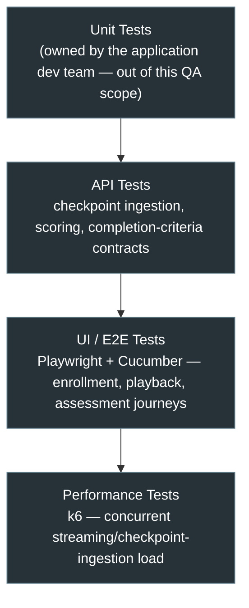
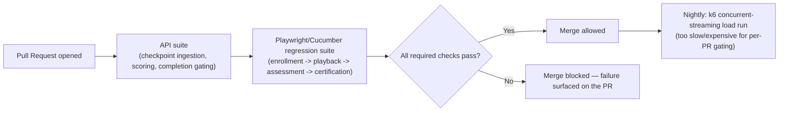

# LMS Platform — Tech Stack & Skills Demonstrated

> Everything in this doc is answerable by reading this repo alone — no need to visit anywhere else
> to understand what was used or why. See [`business-overview.md`](./business-overview.md) for the
> product/module breakdown and [`architecture-and-flow.md`](./architecture-and-flow.md) for how the
> system actually behaves.

## 1. Full Tech Stack, and Why Each Tool

| Category | Tool | Why This Tool Specifically |
|---|---|---|
| **UI Automation** | Playwright + TypeScript | Native video-player interaction support makes it practical to simulate genuine playback and seek-only interaction as distinct, repeatable scenarios (see [`../automation/README.md`](../automation/README.md)) |
| **BDD Framework** | Cucumber | Completion-integrity rules — "seeking to the end should NOT mark a lesson complete," for instance — read as plain business rules a non-QA stakeholder can verify independently. That matters here specifically because this product's output is a credential someone else relies on |
| **API Testing & Automation** | Postman | Validates assessment scoring and completion-criteria gating directly against the contract, independent of what the player UI happens to display |
| **Performance Testing** | k6 | Load and spike testing for concurrent content-streaming and checkpoint-ingestion volume (section 5 below) — chosen to stay in the same JS ecosystem as Playwright |
| **CI/CD** | Jenkins / GitHub Actions | Automates the regression suite on a schedule/trigger — see section 4 for the suggested pipeline shape |
| **Bug Tracking & Traceability** | JIRA, RTM | Full defect lifecycle tracking plus requirement-to-test-coverage traceability — see [`../sample-rtm.md`](../sample-rtm.md) |
| **Version Control** | Git, GitHub | This repo itself; every diagram is Mermaid, which GitHub renders natively with zero extra tooling |

## 2. Skills Demonstrated — Skill → Where to See It

| Skill | Demonstrated By | Where to Look |
|---|---|---|
| **Manual / Functional Testing** | The full enrollment-to-certification regression suite | [`../regression-checklist.md`](../regression-checklist.md) |
| **API Testing** | Assessment scoring and completion-criteria gating contract validation | [`../regression-checklist.md`](../regression-checklist.md) section 3 |
| **UI Automation** | A Playwright + Cucumber spec covering genuine-playback vs. seek-only interaction | [`../automation/sample-progress-tracking.feature`](../automation/sample-progress-tracking.feature) |
| **BDD / Business-Readable Test Design** | Feature files written so an L&D/Compliance stakeholder, not just a QA engineer, can verify the rule under test | [`../automation/sample-progress-tracking.feature`](../automation/sample-progress-tracking.feature) |
| **Negative Testing** | A dedicated test category for seek-without-watching and failed-assessment certification blocking (a score-near-threshold negative case for unanswered-question scoring remains an open gap — see [`../sample-rtm.md`](../sample-rtm.md) REQ-506) | [`../regression-checklist.md`](../regression-checklist.md) sections 2–3 |
| **Performance Testing** | k6-based load and spike testing for concurrent content-streaming volume | Section 5 below |
| **Cross-Content-Package Consistency Testing** | A dedicated test category treating SCORM/xAPI authoring-tool variability as its own dimension, not an edge case | [`../regression-checklist.md`](../regression-checklist.md) `TC-007` |
| **Requirement Traceability (RTM)** | A worked requirement → test case → status mapping | [`../sample-rtm.md`](../sample-rtm.md) |
| **Defect Management & Root-Cause Analysis** | Worked defects that identify the actual mechanism — a position check instead of checkpoint verification, a scoring denominator that excludes unanswered questions — rather than just the symptom | [`../sample-defect-report.md`](../sample-defect-report.md) |
| **Test Reporting & Metrics** | A structured execution summary with a pass/fail breakdown by area | [`../regression-execution-summary.md`](../regression-execution-summary.md) |
| **Technical Documentation & Communication** | This entire `docs/` set | This doc set, start to finish |

## 3. The Testing Pyramid Applied to This Project

The top layer here is a race-condition-adjacent test, not a generic load test. Per section 4 of
[`architecture-and-flow.md`](./architecture-and-flow.md), the defect this layer exists to catch
only has a realistic chance of reproducing when a meaningful number of checkpoint events are
genuinely arriving *at the same time*. A single sequential test can confirm the logic is correct;
only concurrent load gives a gap in that logic enough chances to actually surface.

## 4. CI/CD — Suggested Pipeline Shape

> This repo includes one representative Cucumber feature and Playwright step-definition pair
> rather than the full framework, to stay focused as a portfolio piece (see
> [`../automation/README.md`](../automation/README.md)). The pipeline below is the suggested shape
> automation is designed to slot into — not a claim that a live CI instance is currently running
> against this repo.

## 5. Performance Testing, In Depth

An LMS's traffic is naturally bursty around deadlines and launches rather than steady — a
mandatory-training compliance deadline, or a new cohort's course launch, can send a large fraction
of the learner base into the same lesson within a short window.

| Test Type | What It Targets | Why It Matters Here Specifically |
|---|---|---|
| **Concurrent content-streaming load test** | Many learners streaming the same video lesson at once | Content Delivery (section 1 of [`architecture-and-flow.md`](./architecture-and-flow.md)) is this platform's highest-bandwidth path — a bottleneck here is the first thing learners notice |
| **Checkpoint-ingestion spike test** | A burst of checkpoint events arriving at Progress Tracking simultaneously, as every concurrent viewer emits its own event stream | If ingestion falls behind under load, the correctness logic in section 3 of `architecture-and-flow.md` — verifying every required checkpoint arrived — is only as good as whether those events actually arrive and get processed before a learner's session ends |
| **Deadline-driven enrollment/assessment spike test** | A compliance deadline driving many learners to finish content and submit assessments in the final day(s) before it | A predictable, recurring pattern for mandatory-training LMS deployments, not a rare edge case |

This isn't a claim that an LMS needs the sustained transaction throughput of a payment engine. The
realistic risk is concentrated, deadline-driven bursts of read-heavy (streaming) and write-heavy
(checkpoint/assessment submission) traffic landing in the same narrow window — worth testing as
its own pattern rather than reusing a generic load-test template.

## 6. Why This Doc Exists Separately From business-overview.md

[`business-overview.md`](./business-overview.md) covers *what* this module is and *why* its risk
model looks the way it does. This doc covers a different question — how that actually gets tested,
and with what — so a reader scanning for technical or skill evidence doesn't have to dig it out of
the business-context narrative, and vice versa.
